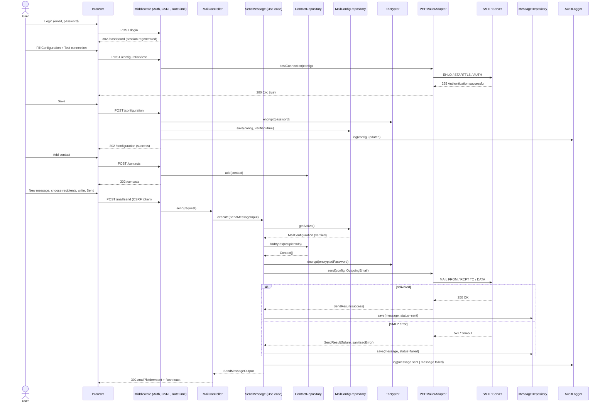
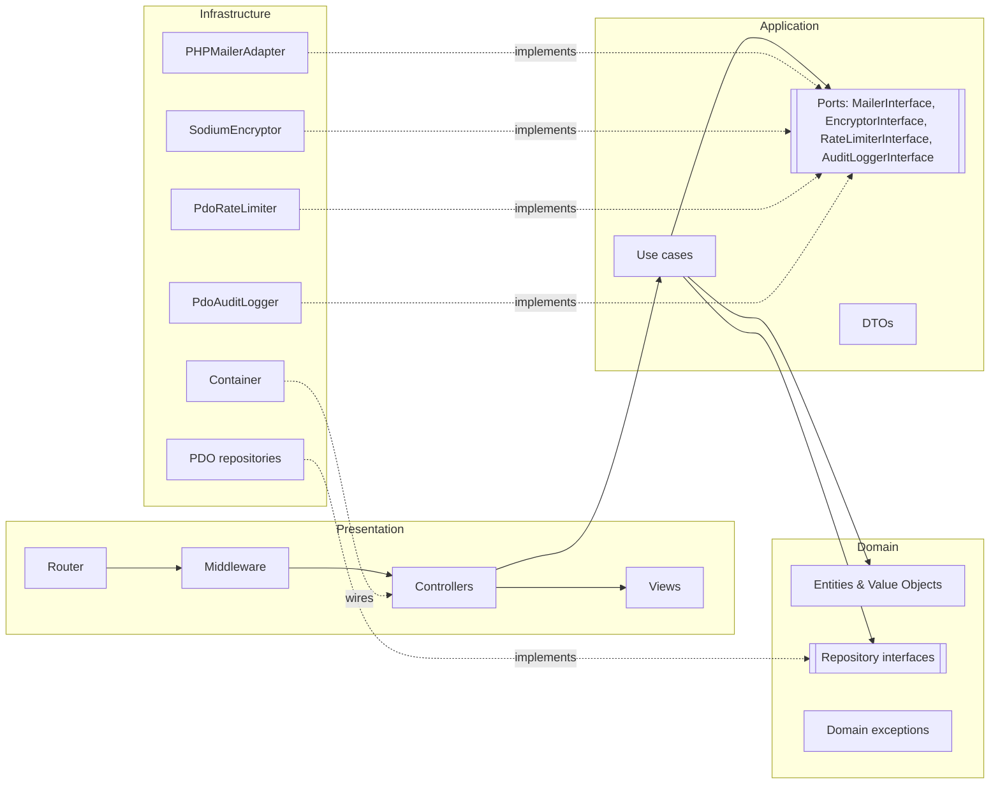
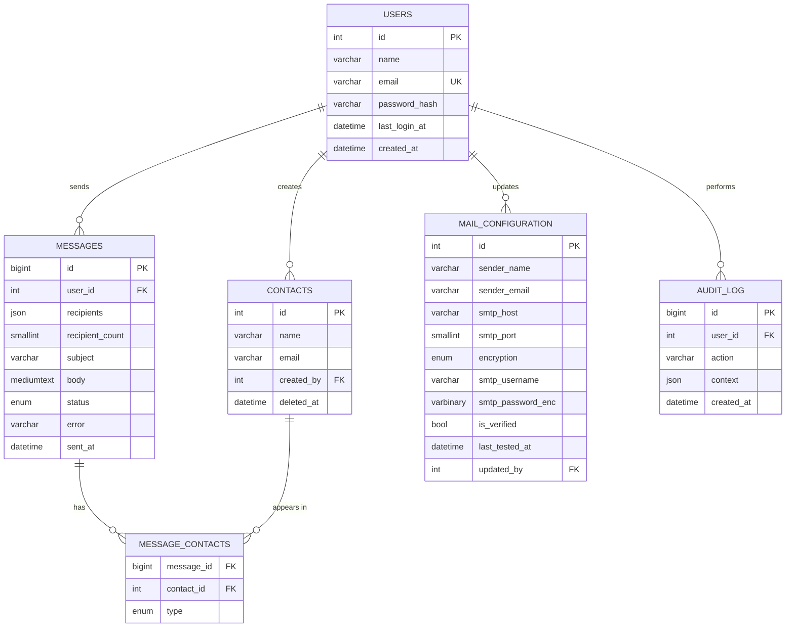

# MailDesk
## Product Design & Requirements Document (PDR)

| Field | Value |
|---|---|
| Product | MailDesk – Internal Contact Mailer |
| Document version | 1.0 |
| Status | Draft for review |
| Date | 9 November 2026 |
| Author | _[Author name]_ |
| Reviewers | _[Reviewer names]_ |
| Target stack | PHP 8.2+, Composer, MySQL 8 / SQLite 3, PHPMailer 6 |

---

## Table of Contents

1. [Product Overview](#1-product-overview)
2. [Primary User Flow](#2-primary-user-flow)
3. [Pages and Screens](#3-pages-and-screens)
4. [Architecture: Clean Architecture in PHP](#4-architecture-clean-architecture-in-php)
5. [Data Model](#5-data-model)
6. [Security](#6-security)
7. [Functional and Non-Functional Requirements](#7-functional-and-non-functional-requirements)
8. [API / Routes](#8-api--routes)
9. [Testing Strategy](#9-testing-strategy)
10. [Deployment and Setup](#10-deployment-and-setup)
11. [Risks, Assumptions and Future Enhancements](#11-risks-assumptions-and-future-enhancements)
- [Appendix A – Glossary](#appendix-a--glossary)

---

## 1. Product Overview

### 1.1 Purpose
MailDesk is a small, self-hosted internal web application that lets an authenticated staff member send emails to a saved list of contacts through the organisation's own SMTP account. It replaces ad-hoc copy-paste of addresses into personal mail clients with a controlled, logged and secure tool.

### 1.2 Scope
In scope (v1.0):

| # | Capability | Description |
|---|---|---|
| C1 | Mail configuration | Configure sender name, sender email and SMTP settings; test the connection; save. |
| C2 | Contact management | Add, edit, delete and search contacts (name + email). |
| C3 | Compose and send | Outlook-style mail page; choose one or more recipients from contacts; write subject and body; send. |
| C4 | Dashboard | KPIs (contacts, sent, failed, last sent), recent messages, configuration status. |
| C5 | Message history | Sent and Failed folders with a reading pane. |
| C6 | Security | Authentication, encrypted secrets, CSRF, rate limiting, audit log. |

Out of scope (v1.0): attachments, templates, scheduled/bulk queues, inbound mail (IMAP), multiple sender accounts, multi-tenant use, OAuth2 mail providers (see §11).

### 1.3 Users and roles

| Role | Description | Permissions (v1.0) |
|---|---|---|
| Admin | The only role in v1.0. Created at install time via CLI. | All features. |

### 1.4 Goals and success metrics

| Goal | Metric | Target |
|---|---|---|
| Fast sending | Time from opening Mail to message sent (5 recipients) | < 60 seconds |
| Reliability | Messages sent successfully when config is valid | ≥ 99% |
| Security | Secrets stored in plain text | 0 |
| Traceability | Sent/failed messages with a log record | 100% |

---

## 2. Primary User Flow

### 2.1 Use case UC-01: Configure, manage contacts, and send an email

| Item | Detail |
|---|---|
| Actor | Admin user |
| Preconditions | MailDesk is installed; an Admin account exists; SMTP credentials are available. |
| Trigger | User wants to send an email to one or more saved contacts. |
| Postconditions (success) | Email delivered to the SMTP server; `messages` row with `status = sent`; audit log entry; success toast shown. |
| Postconditions (failure) | `messages` row with `status = failed` and sanitised error; error toast shown; no secrets exposed. |

**Main success scenario**

| Step | Actor | Action | System response |
|---|---|---|---|
| 1 | User | Opens `/login`, enters email and password, submits. | Validates CSRF + credentials, regenerates session ID, redirects to `/dashboard`. |
| 2 | User | Opens **Configuration**. | Shows SMTP form; password field empty with placeholder "•••••• (saved)" if one exists. |
| 3 | User | Enters sender name, sender email, SMTP host, port, encryption (TLS/SSL/None), username, password. | Client-side validation of formats. |
| 4 | User | Clicks **Test connection**. | Server opens an SMTP connection and authenticates (no mail sent). Shows "Connection successful" or a sanitised error. |
| 5 | User | Clicks **Save**. | Validates; encrypts password; stores config with `is_verified = 1` if the test passed for these exact values; writes audit log; shows success toast. |
| 6 | User | Opens **Contacts**, clicks **Add contact**, enters name + email, saves. | Validates format and uniqueness; inserts row; refreshes table. |
| 7 | User | Deletes an unwanted contact, confirms in the dialog. | Deletes row (soft delete); shows toast. |
| 8 | User | Opens **Mail**, clicks **New message**. | Opens compose form in the right pane. |
| 9 | User | Types in the **To** field. | Autocomplete lists matching contacts (name + email); user selects one or more as chips. |
| 10 | User | Writes subject and body, clicks **Send**. | Validates; checks config verified; checks rate limit; sends via SMTP; logs message; shows toast; message appears in **Sent**. |

**Alternative / exception flows**

| ID | Condition | System behaviour |
|---|---|---|
| A1 | Invalid login | Generic "Invalid email or password"; attempt counted toward rate limit. |
| A2 | Test connection fails | Show sanitised reason (e.g. "Authentication failed", "Host unreachable"); Save still allowed but config stored with `is_verified = 0`. |
| A3 | Duplicate contact email | Inline error "A contact with this email already exists." |
| A4 | Config missing or unverified | **Send** button disabled; banner: "Sending is disabled. Configure and test your mail account on the Configuration page." with link. Server also rejects with HTTP 409. |
| A5 | SMTP error during send | Message saved with `status = failed`; error toast; message appears in **Failed** folder with **Retry** action. |
| A6 | Rate limit exceeded | HTTP 429; toast "Too many messages. Try again in N seconds." |
| A7 | More than max recipients | Inline error "Maximum 50 recipients per message." |
| A8 | Session expired | Redirect to `/login?expired=1`; draft content kept in browser `sessionStorage`. |

### 2.2 Sequence diagram



---

## 3. Pages and Screens

Global layout: top bar (logo "MailDesk", configuration status badge, user menu with **Logout**), left navigation (Dashboard, Mail, Contacts, Configuration). Toast notifications appear top-right and auto-dismiss after 5 s (errors stay until closed).

### 3.1 Login page (`/login`)

| Aspect | Specification |
|---|---|
| Purpose | Authenticate the user. |
| Fields | Email (required, valid email, max 254); Password (required, masked, max 128). |
| Buttons | **Sign in**. |
| Validation | Required fields; email format; CSRF token. |
| Empty state | N/A. |
| Error states | "Invalid email or password." (generic, no user enumeration); "Too many attempts. Try again in 15 minutes."; "Your session expired. Please sign in again." |

```
+--------------------------------------------------+
|                     MailDesk                     |
|                                                  |
|        +------------------------------+          |
|        | Email                        |          |
|        | [___________________________]|          |
|        | Password                     |          |
|        | [***************************]|          |
|        |                              |          |
|        |        [   Sign in   ]        |          |
|        +------------------------------+          |
|   ! Invalid email or password.                   |
+--------------------------------------------------+
```

### 3.2 Dashboard (`/dashboard`)

| Aspect | Specification |
|---|---|
| Purpose | At-a-glance status of contacts, sending activity and configuration. |
| Elements | KPI cards: **Total contacts**, **Emails sent**, **Failed**, **Last sent** (date/time). Configuration badge: green "Configured" / red "Not configured" / amber "Not verified". Recent messages table (last 10): Date, Recipients, Subject, Status. |
| Buttons | **New message** (opens `/mail/compose`); **Go to Configuration** (shown when not configured). |
| Empty state | "No messages yet. Add contacts and send your first message." with buttons **Add contact** and **New message**. |
| Error states | If stats fail to load: "Statistics are unavailable right now." (logged server-side). |

```
+----------------------------------------------------------------------+
| MailDesk                         [● Configured]          Admin ▼     |
+-----------+----------------------------------------------------------+
| Dashboard |  +-----------+ +-----------+ +-----------+ +------------+ |
| Mail      |  | Contacts  | | Sent      | | Failed    | | Last sent  | |
| Contacts  |  |   128     | |   342     | |    3      | | 09 Nov 14:20| |
| Config    |  +-----------+ +-----------+ +-----------+ +------------+ |
|           |                                     [ + New message ]    |
|           |  Recent messages                                         |
|           |  +-----------+----------------+-------------+---------+  |
|           |  | Date      | Recipients     | Subject     | Status  |  |
|           |  +-----------+----------------+-------------+---------+  |
|           |  | 09 Nov    | ali@x.com (+2) | Meeting     | Sent    |  |
|           |  | 08 Nov    | sara@y.org     | Report      | Failed  |  |
|           |  +-----------+----------------+-------------+---------+  |
+-----------+----------------------------------------------------------+
```

### 3.3 Configuration page (`/configuration`)

| Aspect | Specification |
|---|---|
| Purpose | Store the sender account used for all outgoing mail. |
| Fields | Sender name (required, 1–100 chars); Sender email (required, valid email); SMTP host (required, hostname or IP, max 255); Port (required, integer 1–65535, default 587); Encryption (select: TLS / SSL / None; default TLS); Username (required, max 254); Password (masked; required on first save, optional afterwards — empty means "keep existing"). |
| Buttons | **Test connection** (AJAX, does not save); **Save**; **Reset** (reload saved values). |
| Validation | All formats above; warning if Encryption = None ("Credentials will be sent unencrypted"); port/encryption mismatch hint (465 ↔ SSL, 587 ↔ TLS). |
| Display rules | The saved password is **never** returned to the browser. Field shows placeholder "•••••• (saved)". |
| Status | "Last tested: 09 Nov 2026 14:02 – Success" / "Not verified". |
| Empty state | Info box: "No mail account configured yet. Sending is disabled until you save and test a configuration." |
| Error states | Test failure messages: "Could not connect to host", "TLS negotiation failed", "Authentication failed (check username/password)", "Timed out after 10 s". |

```
+----------------------------------------------------------------------+
| Configuration                          Status: ● Verified 09 Nov 14:02|
+----------------------------------------------------------------------+
| Sender name    [ Nawasi Admin                               ]        |
| Sender email   [ admin@example.org                          ]        |
| SMTP host      [ smtp.office365.com                         ]        |
| Port           [ 587 ]    Encryption  [ TLS ▼ ]                       |
| Username       [ admin@example.org                          ]        |
| Password       [ •••••• (saved)                             ]        |
|                                                                      |
|   [ Test connection ]      [ Reset ]          [   Save   ]           |
|   ✔ Connection successful                                            |
+----------------------------------------------------------------------+
```

### 3.4 Contacts page (`/contacts`)

| Aspect | Specification |
|---|---|
| Purpose | Maintain the list of recipients. |
| Table columns | Checkbox, Name, Email, Created, Actions (Edit, Delete). |
| Features | Search (name or email, debounced 300 ms, server-side); sort by Name/Email/Created; pagination (20 per page). |
| Buttons | **Add contact** (opens modal); **Edit**; **Delete** (confirmation dialog); **Send to selected** (opens compose pre-filled). |
| Add/Edit fields | Name (required, 1–100 chars, trimmed); Email (required, valid RFC 5322 via `filter_var`, max 254, stored lower-case, unique). |
| Validation | Duplicate email → "A contact with this email already exists."; invalid email → "Enter a valid email address." |
| Delete confirmation | "Delete Ali Ahmed (ali@example.com)? This cannot be undone." **Cancel** / **Delete**. |
| Empty state | "No contacts yet." + **Add contact**. Search empty: "No contacts match 'xyz'." |
| Error states | Save failure toast; stale delete (already deleted) → "Contact no longer exists." |

```
+----------------------------------------------------------------------+
| Contacts                 [ Search name or email...  ] [ + Add contact]|
+----------------------------------------------------------------------+
| [ ] | Name ▲         | Email               | Created  | Actions      |
| [x] | Ali Ahmed      | ali@example.com     | 01 Nov   | Edit  Delete |
| [ ] | Sara Mohamed   | sara@example.org    | 03 Nov   | Edit  Delete |
| [x] | Omar Salem     | omar@example.net    | 05 Nov   | Edit  Delete |
+----------------------------------------------------------------------+
| 2 selected  [ Send to selected ]            « 1 2 3 »  (20 per page) |
+----------------------------------------------------------------------+

   +------------- Add contact --------------+
   | Name   [ ____________________ ]        |
   | Email  [ ____________________ ]        |
   |               [ Cancel ] [ Save ]      |
   +----------------------------------------+
```

### 3.5 Mail page – Outlook-style (`/mail`)

| Aspect | Specification |
|---|---|
| Purpose | Compose and send messages; browse sent and failed messages. |
| Left pane (folders) | **New message** button, **Sent** (count), **Failed** (count, red badge). |
| Middle pane (list) | Rows: Recipient(s) (first + "+N"), Subject, Date, Status icon. Search box; 25 per page; selected row highlighted. |
| Right pane | **Reading pane** (From, To, Cc, Date, Subject, Body, Status, Error if failed, **Retry** for failed, **Forward**) or **Compose form**. |
| Compose fields | To (required; autocomplete chips from contacts; max 50 total recipients); Cc (optional, same control); Subject (required, 1–200 chars, CR/LF stripped); Body (required, max 100 000 chars; basic rich text: bold, italic, underline, bullet list, numbered list, link). |
| Buttons | **Send**, **Discard** (confirm if content exists). |
| Validation | At least one To recipient; recipients must be existing contacts (server checks IDs); subject/body required. |
| Disabled state | If config is missing/unverified: Send disabled + banner with link to Configuration. |
| Empty states | Sent: "No sent messages yet." Failed: "No failed messages." Reading pane: "Select a message to read it." |
| Error states | SMTP failure toast; 429 rate-limit toast; validation messages under each field. |
| Responsive | ≥ 1200 px: three panes. 768–1199 px: folders collapse to icon rail. < 768 px: one pane at a time with back arrow (Folders → List → Message/Compose). |

```
+----------------------------------------------------------------------------+
| MailDesk                              [● Configured]               Admin ▼ |
+--------------+------------------------------+------------------------------+
| [+ New msg]  | [ Search mail...           ] | To:  [Ali Ahmed ×][Sara M. ×]|
|              |------------------------------|      [ type a name...      ] |
| ▸ Sent   342 | ● Ali Ahmed (+2)     14:20   | Cc:  [                     ] |
| ▸ Failed   3 |   Meeting tomorrow    Sent   | Subject: [ Meeting tomorrow ]|
|              |------------------------------| [B][I][U][•][1.][link]       |
|              |   Sara Mohamed       08 Nov  | +--------------------------+ |
|              |   Monthly report      Failed | | Dear all,                | |
|              |------------------------------| | ...                      | |
|              |   Omar Salem         05 Nov  | +--------------------------+ |
|              |   Invoice             Sent   |   [ Send ]     [ Discard ]   |
+--------------+------------------------------+------------------------------+
```

---

## 4. Architecture: Clean Architecture in PHP

### 4.1 Technology stack

| Concern | Choice | Notes |
|---|---|---|
| Language | PHP 8.2+ | `readonly` classes, enums, strict types (`declare(strict_types=1)` everywhere). |
| Dependencies | Composer 2 | PSR-4 autoload `MailDesk\\` → `src/`. |
| Code style | PSR-12 | Enforced with PHP_CodeSniffer; static analysis with PHPStan level 8. |
| Database | MySQL 8 (production) or SQLite 3 (small installs/tests) | Accessed only through PDO. |
| Mail | PHPMailer 6 | Wrapped behind `MailerInterface`; Symfony Mailer is a drop-in alternative. |
| Routing | `nikic/fast-route` | Light router, no full framework. |
| Env | `vlucas/phpdotenv` | Loads `.env`. |
| Templates | Plain PHP templates with an `e()` escape helper | (Twig optional.) |
| Encryption | `ext-sodium` | `sodium_crypto_secretbox`. |
| Tests | PHPUnit 11 | Plus Mockery optional. |
| Front-end | Vanilla JS + small CSS; rich text via Quill 2 or contenteditable | No build step required. |

### 4.2 Layers and the dependency rule

Dependencies point **inward only**: Presentation → Application → Domain; Infrastructure implements interfaces defined in Domain/Application. Domain has zero dependencies on frameworks, PDO or PHPMailer.

| Layer | Responsibility | Contents |
|---|---|---|
| **Domain** | Business rules, framework-free. | Entities: `User`, `Contact`, `MailConfiguration`, `Message`. Value objects: `EmailAddress`, `MessageStatus` (enum), `Encryption` (enum). Repository interfaces. Domain exceptions: `InvalidEmailAddress`, `DuplicateContact`, `ConfigurationNotVerified`, `TooManyRecipients`. |
| **Application** | Use cases orchestrating domain objects. | Use cases: `SaveConfiguration`, `TestConfiguration`, `AddContact`, `UpdateContact`, `DeleteContact`, `ListContacts`, `SendMessage`, `RetryMessage`, `ListMessages`, `GetDashboardStats`, `Authenticate`. Input/Output DTOs. Service interfaces: `MailerInterface`, `EncryptorInterface`, `PasswordHasherInterface`, `RateLimiterInterface`, `AuditLoggerInterface`, `ClockInterface`. |
| **Infrastructure** | Technical implementations. | `Pdo*Repository` classes, `PHPMailerAdapter`, `SodiumEncryptor`, `NativePasswordHasher`, `PdoRateLimiter`, `PdoAuditLogger`, `NativeSession`, `EnvConfig`, migrations. |
| **Presentation** | HTTP in/out. | Front controller, router, controllers, middleware (`AuthMiddleware`, `CsrfMiddleware`, `RateLimitMiddleware`, `SecurityHeadersMiddleware`), views, flash messages, JSON responses for AJAX. |

### 4.3 Folder structure

```
maildesk/
├── bin/
│   ├── console                     # CLI entry (migrate, user:create)
│   └── migrate.php
├── config/
│   ├── container.php               # DI bindings
│   ├── routes.php                  # Route table
│   └── settings.php                # Reads env → typed settings
├── database/
│   └── migrations/
│       ├── 001_create_users.sql
│       ├── 002_create_mail_configuration.sql
│       ├── 003_create_contacts.sql
│       ├── 004_create_messages.sql
│       ├── 005_create_audit_log.sql
│       └── 006_create_rate_limits.sql
├── public/
│   ├── index.php                   # Front controller (only web-exposed PHP file)
│   └── assets/
│       ├── css/app.css
│       └── js/{app.js,compose.js,contacts.js}
├── src/
│   ├── Domain/
│   │   ├── Contact/{Contact.php,ContactRepositoryInterface.php}
│   │   ├── Configuration/{MailConfiguration.php,MailConfigurationRepositoryInterface.php,Encryption.php}
│   │   ├── Message/{Message.php,MessageStatus.php,MessageRepositoryInterface.php}
│   │   ├── User/{User.php,UserRepositoryInterface.php}
│   │   ├── Shared/EmailAddress.php
│   │   └── Exception/{DomainException.php,InvalidEmailAddress.php,DuplicateContact.php,
│   │                  ConfigurationNotVerified.php,TooManyRecipients.php}
│   ├── Application/
│   │   ├── Auth/Authenticate.php
│   │   ├── Configuration/{SaveConfiguration.php,TestConfiguration.php,ConfigurationInput.php}
│   │   ├── Contact/{AddContact.php,UpdateContact.php,DeleteContact.php,ListContacts.php,ContactInput.php}
│   │   ├── Mail/{SendMessage.php,SendMessageInput.php,SendMessageOutput.php,RetryMessage.php,ListMessages.php}
│   │   ├── Dashboard/{GetDashboardStats.php,DashboardStats.php}
│   │   └── Port/{MailerInterface.php,OutgoingEmail.php,SendResult.php,EncryptorInterface.php,
│   │             PasswordHasherInterface.php,RateLimiterInterface.php,AuditLoggerInterface.php,ClockInterface.php}
│   ├── Infrastructure/
│   │   ├── Persistence/{PdoFactory.php,PdoContactRepository.php,PdoMessageRepository.php,
│   │   │                PdoMailConfigurationRepository.php,PdoUserRepository.php}
│   │   ├── Mail/PHPMailerAdapter.php
│   │   ├── Security/{SodiumEncryptor.php,NativePasswordHasher.php,PdoRateLimiter.php,CsrfTokenManager.php}
│   │   ├── Logging/{PdoAuditLogger.php,FileErrorLogger.php}
│   │   ├── Session/NativeSession.php
│   │   └── Container/Container.php
│   └── Presentation/
│       ├── Http/{Kernel.php,Request.php,Response.php,Router.php}
│       ├── Middleware/{AuthMiddleware.php,CsrfMiddleware.php,RateLimitMiddleware.php,SecurityHeadersMiddleware.php}
│       ├── Controller/{AuthController.php,DashboardController.php,ConfigurationController.php,
│       │               ContactController.php,MailController.php}
│       └── View/
│           ├── layout.php
│           ├── helpers.php          # e(), csrf_field(), flash()
│           ├── auth/login.php
│           ├── dashboard/index.php
│           ├── configuration/index.php
│           ├── contacts/index.php
│           └── mail/{index.php,_list.php,_reading.php,_compose.php}
├── storage/logs/                   # Not web-accessible
├── tests/
│   ├── Unit/{Domain,Application}/
│   ├── Integration/Persistence/
│   └── bootstrap.php
├── .env.example
├── .gitignore                      # .env, vendor/, storage/
├── composer.json
├── phpcs.xml
├── phpstan.neon
└── phpunit.xml
```

### 4.4 Dependency diagram



### 4.5 Dependency injection

A minimal PSR-11-style container (`src/Infrastructure/Container/Container.php`) registers factories in `config/container.php`:

```php
<?php
declare(strict_types=1);

use MailDesk\Application\Mail\SendMessage;
use MailDesk\Application\Port\{MailerInterface, EncryptorInterface, AuditLoggerInterface, RateLimiterInterface, ClockInterface};
use MailDesk\Domain\Contact\ContactRepositoryInterface;
use MailDesk\Domain\Configuration\MailConfigurationRepositoryInterface;
use MailDesk\Domain\Message\MessageRepositoryInterface;
use MailDesk\Infrastructure\Container\Container;
use MailDesk\Infrastructure\Mail\PHPMailerAdapter;
use MailDesk\Infrastructure\Persistence\{PdoFactory, PdoContactRepository, PdoMailConfigurationRepository, PdoMessageRepository};
use MailDesk\Infrastructure\Security\{SodiumEncryptor, PdoRateLimiter};
use MailDesk\Infrastructure\Logging\PdoAuditLogger;
use MailDesk\Presentation\Controller\MailController;

return static function (Container $c, array $settings): void {
    $c->singleton(PDO::class, fn () => PdoFactory::create($settings['db']));
    $c->singleton(EncryptorInterface::class, fn () => new SodiumEncryptor($settings['app_key']));
    $c->singleton(MailerInterface::class, fn () => new PHPMailerAdapter(timeoutSeconds: 10));
    $c->singleton(ContactRepositoryInterface::class, fn ($c) => new PdoContactRepository($c->get(PDO::class)));
    $c->singleton(MailConfigurationRepositoryInterface::class, fn ($c) => new PdoMailConfigurationRepository($c->get(PDO::class)));
    $c->singleton(MessageRepositoryInterface::class, fn ($c) => new PdoMessageRepository($c->get(PDO::class)));
    $c->singleton(AuditLoggerInterface::class, fn ($c) => new PdoAuditLogger($c->get(PDO::class)));
    $c->singleton(RateLimiterInterface::class, fn ($c) => new PdoRateLimiter($c->get(PDO::class)));
    $c->singleton(ClockInterface::class, fn () => new class implements ClockInterface {
        public function now(): DateTimeImmutable { return new DateTimeImmutable('now', new DateTimeZone('UTC')); }
    });

    $c->bind(SendMessage::class, fn ($c) => new SendMessage(
        $c->get(MailConfigurationRepositoryInterface::class),
        $c->get(ContactRepositoryInterface::class),
        $c->get(MessageRepositoryInterface::class),
        $c->get(MailerInterface::class),
        $c->get(EncryptorInterface::class),
        $c->get(AuditLoggerInterface::class),
        $c->get(ClockInterface::class),
        maxRecipients: (int) $settings['mail_max_recipients'],
    ));
    $c->bind(MailController::class, fn ($c) => new MailController($c->get(SendMessage::class)));
};
```

### 4.6 End-to-end code skeleton: SendMessage

**Domain – value object**

```php
<?php
declare(strict_types=1);

namespace MailDesk\Domain\Shared;

use MailDesk\Domain\Exception\InvalidEmailAddress;

final readonly class EmailAddress
{
    public string $value;

    public function __construct(string $value)
    {
        $value = strtolower(trim($value));
        if (strlen($value) > 254
            || preg_match('/[\r\n]/', $value)
            || filter_var($value, FILTER_VALIDATE_EMAIL) === false) {
            throw new InvalidEmailAddress($value);
        }
        $this->value = $value;
    }

    public function equals(self $other): bool { return $this->value === $other->value; }
    public function __toString(): string { return $this->value; }
}
```

**Domain – entity and repository interface**

```php
<?php
declare(strict_types=1);

namespace MailDesk\Domain\Message;

enum MessageStatus: string { case Sent = 'sent'; case Failed = 'failed'; }

final class Message
{
    /** @param list<array{name:string,email:string}> $to @param list<array{name:string,email:string}> $cc */
    public function __construct(
        public readonly ?int $id,
        public readonly int $userId,
        public readonly array $to,
        public readonly array $cc,
        public readonly string $subject,
        public readonly string $bodyHtml,
        public readonly MessageStatus $status,
        public readonly ?string $error,
        public readonly \DateTimeImmutable $sentAt,
    ) {}
}

interface MessageRepositoryInterface
{
    public function save(Message $message): int;
    public function findById(int $id): ?Message;
    /** @return list<Message> */
    public function listByStatus(MessageStatus $status, int $page, int $perPage): array;
}
```

**Application – ports**

```php
<?php
declare(strict_types=1);

namespace MailDesk\Application\Port;

use MailDesk\Domain\Configuration\MailConfiguration;

final readonly class OutgoingEmail
{
    /** @param list<array{name:string,email:string}> $to @param list<array{name:string,email:string}> $cc */
    public function __construct(
        public array $to,
        public array $cc,
        public string $subject,
        public string $bodyHtml,
        public string $bodyText,
    ) {}
}

final readonly class SendResult
{
    private function __construct(public bool $success, public ?string $error) {}
    public static function ok(): self { return new self(true, null); }
    public static function failed(string $sanitisedError): self { return new self(false, $sanitisedError); }
}

interface MailerInterface
{
    public function send(MailConfiguration $config, string $plainPassword, OutgoingEmail $email): SendResult;
    public function testConnection(MailConfiguration $config, string $plainPassword): SendResult;
}

interface EncryptorInterface
{
    public function encrypt(string $plain): string;
    public function decrypt(string $cipher): string;
}
```

**Application – use case**

```php
<?php
declare(strict_types=1);

namespace MailDesk\Application\Mail;

use MailDesk\Application\Port\{AuditLoggerInterface, ClockInterface, EncryptorInterface, MailerInterface, OutgoingEmail};
use MailDesk\Domain\Configuration\MailConfigurationRepositoryInterface;
use MailDesk\Domain\Contact\ContactRepositoryInterface;
use MailDesk\Domain\Exception\{ConfigurationNotVerified, TooManyRecipients, ValidationFailed};
use MailDesk\Domain\Message\{Message, MessageRepositoryInterface, MessageStatus};

final readonly class SendMessageInput
{
    /** @param list<int> $toContactIds @param list<int> $ccContactIds */
    public function __construct(
        public int $userId,
        public array $toContactIds,
        public array $ccContactIds,
        public string $subject,
        public string $bodyHtml,
    ) {}
}

final readonly class SendMessageOutput
{
    public function __construct(public int $messageId, public bool $sent, public ?string $error) {}
}

final class SendMessage
{
    public function __construct(
        private MailConfigurationRepositoryInterface $configs,
        private ContactRepositoryInterface $contacts,
        private MessageRepositoryInterface $messages,
        private MailerInterface $mailer,
        private EncryptorInterface $encryptor,
        private AuditLoggerInterface $audit,
        private ClockInterface $clock,
        private int $maxRecipients = 50,
    ) {}

    public function execute(SendMessageInput $in): SendMessageOutput
    {
        $config = $this->configs->getActive();
        if ($config === null || !$config->isVerified()) {
            throw new ConfigurationNotVerified();
        }

        $subject = trim(str_replace(["\r", "\n"], ' ', $in->subject));
        if ($subject === '' || mb_strlen($subject) > 200) {
            throw new ValidationFailed(['subject' => 'Subject is required (max 200 characters).']);
        }
        if (trim(strip_tags($in->bodyHtml)) === '') {
            throw new ValidationFailed(['body' => 'Message body is required.']);
        }

        $ids = array_values(array_unique([...$in->toContactIds, ...$in->ccContactIds]));
        if ($in->toContactIds === []) {
            throw new ValidationFailed(['to' => 'Choose at least one recipient.']);
        }
        if (count($ids) > $this->maxRecipients) {
            throw new TooManyRecipients($this->maxRecipients);
        }

        $to = $this->contacts->findByIds($in->toContactIds); // throws if any id missing
        $cc = $this->contacts->findByIds($in->ccContactIds);

        $map = static fn ($c) => ['name' => $c->name, 'email' => (string) $c->email];
        $email = new OutgoingEmail(
            to: array_map($map, $to),
            cc: array_map($map, $cc),
            subject: $subject,
            bodyHtml: HtmlSanitizer::clean($in->bodyHtml),   // allow-list: b,i,u,ul,ol,li,a,p,br
            bodyText: HtmlSanitizer::toText($in->bodyHtml),
        );

        $password = $this->encryptor->decrypt($config->encryptedPassword);
        $result = $this->mailer->send($config, $password, $email);
        unset($password);

        $message = new Message(
            id: null,
            userId: $in->userId,
            to: $email->to,
            cc: $email->cc,
            subject: $email->subject,
            bodyHtml: $email->bodyHtml,
            status: $result->success ? MessageStatus::Sent : MessageStatus::Failed,
            error: $result->error,
            sentAt: $this->clock->now(),
        );
        $id = $this->messages->save($message);

        $this->audit->log(
            $in->userId,
            $result->success ? 'message.sent' : 'message.failed',
            ['message_id' => $id, 'recipients' => count($ids)],
        );

        return new SendMessageOutput($id, $result->success, $result->error);
    }
}
```

**Infrastructure – PHPMailer adapter**

```php
<?php
declare(strict_types=1);

namespace MailDesk\Infrastructure\Mail;

use MailDesk\Application\Port\{MailerInterface, OutgoingEmail, SendResult};
use MailDesk\Domain\Configuration\{Encryption, MailConfiguration};
use PHPMailer\PHPMailer\{Exception as MailException, PHPMailer, SMTP};

final class PHPMailerAdapter implements MailerInterface
{
    public function __construct(private int $timeoutSeconds = 10) {}

    public function send(MailConfiguration $config, string $plainPassword, OutgoingEmail $email): SendResult
    {
        $mail = $this->build($config, $plainPassword);
        try {
            $mail->setFrom((string) $config->senderEmail, $config->senderName);
            foreach ($email->to as $r) { $mail->addAddress($r['email'], $r['name']); }
            foreach ($email->cc as $r) { $mail->addCC($r['email'], $r['name']); }
            $mail->Subject = $email->subject;
            $mail->isHTML(true);
            $mail->Body    = $email->bodyHtml;
            $mail->AltBody = $email->bodyText;
            $mail->send();
            return SendResult::ok();
        } catch (MailException) {
            return SendResult::failed($this->sanitise($mail->ErrorInfo));
        } finally {
            $mail->smtpClose();
        }
    }

    public function testConnection(MailConfiguration $config, string $plainPassword): SendResult
    {
        $mail = $this->build($config, $plainPassword);
        try {
            return $mail->smtpConnect() ? SendResult::ok() : SendResult::failed('Could not connect to host.');
        } catch (MailException) {
            return SendResult::failed($this->sanitise($mail->ErrorInfo));
        } finally {
            $mail->smtpClose();
        }
    }

    private function build(MailConfiguration $config, string $plainPassword): PHPMailer
    {
        $mail = new PHPMailer(true);
        $mail->isSMTP();
        $mail->Host       = $config->host;
        $mail->Port       = $config->port;
        $mail->SMTPAuth   = true;
        $mail->Username   = $config->username;
        $mail->Password   = $plainPassword;
        $mail->Timeout    = $this->timeoutSeconds;
        $mail->CharSet    = PHPMailer::CHARSET_UTF8;
        $mail->SMTPDebug  = SMTP::DEBUG_OFF;              // never leak credentials to output
        $mail->SMTPSecure = match ($config->encryption) {
            Encryption::Tls  => PHPMailer::ENCRYPTION_STARTTLS,
            Encryption::Ssl  => PHPMailer::ENCRYPTION_SMTPS,
            Encryption::None => '',
        };
        $mail->SMTPAutoTLS = $config->encryption !== Encryption::None;
        return $mail;
    }

    /** Map raw SMTP errors to safe, user-facing text. */
    private function sanitise(string $raw): string
    {
        return match (true) {
            str_contains($raw, 'authenticate')     => 'Authentication failed (check username/password).',
            str_contains($raw, 'connect')          => 'Could not connect to host.',
            str_contains($raw, 'TLS'),
            str_contains($raw, 'SSL')              => 'TLS negotiation failed.',
            str_contains($raw, 'recipient')        => 'One or more recipients were rejected by the server.',
            default                                => 'The mail server rejected the message.',
        };
    }
}
```

**Presentation – controller**

```php
<?php
declare(strict_types=1);

namespace MailDesk\Presentation\Controller;

use MailDesk\Application\Mail\{SendMessage, SendMessageInput};
use MailDesk\Domain\Exception\{ConfigurationNotVerified, TooManyRecipients, ValidationFailed};
use MailDesk\Presentation\Http\{Request, Response};

final class MailController
{
    public function __construct(private SendMessage $sendMessage) {}

    /** POST /mail/send — Auth + CSRF + RateLimit middleware already applied. */
    public function send(Request $request): Response
    {
        $input = new SendMessageInput(
            userId: $request->userId(),
            toContactIds: array_map('intval', (array) $request->post('to', [])),
            ccContactIds: array_map('intval', (array) $request->post('cc', [])),
            subject: (string) $request->post('subject', ''),
            bodyHtml: (string) $request->post('body', ''),
        );

        try {
            $out = $this->sendMessage->execute($input);
        } catch (ConfigurationNotVerified) {
            return Response::redirect('/mail/compose')
                ->withFlash('error', 'Sending is disabled. Configure and test your mail account first.')
                ->withStatus(409);
        } catch (ValidationFailed | TooManyRecipients $e) {
            return Response::redirect('/mail/compose')->withOldInput($request->post())->withErrors($e->errors());
        }

        return $out->sent
            ? Response::redirect('/mail?folder=sent&id=' . $out->messageId)->withFlash('success', 'Message sent.')
            : Response::redirect('/mail?folder=failed&id=' . $out->messageId)->withFlash('error', 'Sending failed: ' . $out->error);
    }
}
```

---

## 5. Data Model

All timestamps stored in UTC. MySQL: `InnoDB`, `utf8mb4_unicode_ci`. SQLite equivalents use `INTEGER PRIMARY KEY AUTOINCREMENT` and `TEXT` for dates (ISO 8601).

### 5.1 `users`

| Column | Type | Constraints | Notes |
|---|---|---|---|
| id | INT UNSIGNED | PK, AUTO_INCREMENT | |
| name | VARCHAR(100) | NOT NULL | |
| email | VARCHAR(254) | NOT NULL, UNIQUE | Lower-case. |
| password_hash | VARCHAR(255) | NOT NULL | `password_hash(PASSWORD_ARGON2ID)` (fallback BCRYPT). |
| last_login_at | DATETIME | NULL | |
| created_at | DATETIME | NOT NULL | |
| updated_at | DATETIME | NOT NULL | |

Indexes: `uq_users_email (email)`.

### 5.2 `mail_configuration`

| Column | Type | Constraints | Notes |
|---|---|---|---|
| id | INT UNSIGNED | PK, AUTO_INCREMENT | Single active row in v1.0. |
| sender_name | VARCHAR(100) | NOT NULL | |
| sender_email | VARCHAR(254) | NOT NULL | |
| smtp_host | VARCHAR(255) | NOT NULL | |
| smtp_port | SMALLINT UNSIGNED | NOT NULL, CHECK 1–65535 | |
| encryption | ENUM('tls','ssl','none') | NOT NULL DEFAULT 'tls' | |
| smtp_username | VARCHAR(254) | NOT NULL | |
| smtp_password_enc | VARBINARY(512) | NOT NULL | `nonce ‖ ciphertext` from libsodium; base64 if TEXT. |
| is_verified | TINYINT(1) | NOT NULL DEFAULT 0 | Set to 1 only after a successful test of the same values. |
| last_tested_at | DATETIME | NULL | |
| updated_by | INT UNSIGNED | FK → users.id | |
| created_at | DATETIME | NOT NULL | |
| updated_at | DATETIME | NOT NULL | |

Indexes: `fk_config_user (updated_by)`.

### 5.3 `contacts`

| Column | Type | Constraints | Notes |
|---|---|---|---|
| id | INT UNSIGNED | PK, AUTO_INCREMENT | |
| name | VARCHAR(100) | NOT NULL | |
| email | VARCHAR(254) | NOT NULL | Lower-case. |
| created_by | INT UNSIGNED | FK → users.id | |
| created_at | DATETIME | NOT NULL | |
| updated_at | DATETIME | NOT NULL | |
| deleted_at | DATETIME | NULL | Soft delete. |

Indexes: `uq_contacts_email_active (email, deleted_at)` — on MySQL use a generated column `email_active = IF(deleted_at IS NULL, email, NULL)` with a UNIQUE index; `idx_contacts_name (name)`.

### 5.4 `messages`

| Column | Type | Constraints | Notes |
|---|---|---|---|
| id | BIGINT UNSIGNED | PK, AUTO_INCREMENT | |
| user_id | INT UNSIGNED | NOT NULL, FK → users.id | Sender (app user). |
| recipients | JSON | NOT NULL | `{"to":[{"name","email"}],"cc":[...]}` — snapshot at send time so history survives contact deletion. |
| recipient_count | SMALLINT UNSIGNED | NOT NULL | For stats and limits. |
| subject | VARCHAR(200) | NOT NULL | |
| body | MEDIUMTEXT | NOT NULL | Sanitised HTML. |
| status | ENUM('sent','failed') | NOT NULL | |
| error | VARCHAR(500) | NULL | Sanitised, no secrets. |
| sent_at | DATETIME | NOT NULL | Attempt time. |
| created_at | DATETIME | NOT NULL | |

Indexes: `idx_messages_status_sent_at (status, sent_at DESC)`, `idx_messages_user (user_id)`.

### 5.5 Supporting tables

| Table | Columns | Purpose |
|---|---|---|
| `message_contacts` | message_id FK, contact_id FK NULL, type ENUM('to','cc') | Optional link for reporting per contact. |
| `audit_log` | id, user_id FK NULL, action VARCHAR(50), context JSON, ip VARBINARY(16), user_agent VARCHAR(255), created_at | Config changes, logins, contact changes, sends. Index `(action, created_at)`. |
| `rate_limits` | key VARCHAR(100) PK, hits INT, window_start DATETIME | Fixed-window counters (e.g. `login:ip:1.2.3.4`, `send:user:1`). |

### 5.6 ERD



---

## 6. Security

Security is driven by the configuration: secrets come from `.env`, mail credentials come from the encrypted `mail_configuration` row, and sending is only possible when that configuration is saved **and** verified.

### 6.1 Security controls

| ID | Control | Why it exists | Implementation |
|---|---|---|---|
| SEC-01 | Password hashing | Stolen DB must not reveal user passwords. | `password_hash($pw, PASSWORD_ARGON2ID)`; `password_verify()`; `password_needs_rehash()` on login. Minimum 12 characters. |
| SEC-02 | Session hardening | Prevent session fixation and hijacking. | `session_regenerate_id(true)` on login and privilege change; idle timeout 30 min, absolute timeout 8 h (stored `last_activity`, `created` in session); logout destroys session and cookie. `session.use_strict_mode=1`, `session.use_only_cookies=1`. |
| SEC-03 | Cookie flags | Block JS access and cross-site sending. | `session_set_cookie_params(['httponly'=>true,'secure'=>APP_ENV==='production','samesite'=>'Strict','path'=>'/'])`. Cookie name `maildesk_sid`. |
| SEC-04 | SMTP password encrypted at rest | DB dump must not reveal mail credentials. | `SodiumEncryptor`: `APP_KEY` (32 bytes, base64 in `.env`); `sodium_crypto_secretbox($plain, $nonce, $key)` with random 24-byte nonce; store `nonce‖cipher`. Decrypt only inside `SendMessage`/`TestConfiguration`; `sodium_memzero()` after use. Key never in DB or code. |
| SEC-05 | Password never returned to UI | Prevent leakage through HTML/source/view. | Config view model omits the password; form field always empty; empty value on save = keep existing ciphertext. |
| SEC-06 | Secrets in `.env` | Keep secrets out of source control. | `vlucas/phpdotenv`; `.env` in `.gitignore`; `.env.example` with placeholders; `.env` permissions `0600`, outside web root. App refuses to boot if `APP_KEY` missing or wrong length. |
| SEC-07 | CSRF protection | Stop forged state-changing requests. | `CsrfMiddleware` on all POST/PUT/DELETE: per-session token (`random_bytes(32)`), hidden field `_csrf` or `X-CSRF-Token` header for AJAX; `hash_equals()` comparison; 419 on mismatch. |
| SEC-08 | Input validation | Reject malformed data early. | Domain value objects (`EmailAddress`) and use-case validators: lengths per §3, `filter_var(FILTER_VALIDATE_EMAIL)`, integer ranges, enum whitelist for encryption. Server-side validation is authoritative. |
| SEC-09 | Output escaping (XSS) | Prevent script injection in views. | `e()` helper = `htmlspecialchars($v, ENT_QUOTES \| ENT_SUBSTITUTE, 'UTF-8')` for every echo. Message HTML body sanitised with an allow-list (HTML Purifier or `symfony/html-sanitizer`) before storing and before display; reading pane renders it inside a sandboxed `<iframe sandbox>` with `srcdoc`. |
| SEC-10 | SQL injection prevention | Protect the database. | PDO with `ATTR_EMULATE_PREPARES=false`, `ERRMODE_EXCEPTION`; prepared statements only; ORDER BY columns from a whitelist. No string-concatenated SQL. |
| SEC-11 | Email header injection prevention | Stop attackers adding Bcc/headers. | Strip `\r` and `\n` from subject, sender name and addresses; recipients only from contact IDs (not free text); `EmailAddress` rejects CR/LF; PHPMailer's own `addAddress()` validation. |
| SEC-12 | Rate limiting | Stop brute force and abuse of the SMTP account. | `PdoRateLimiter`: Login 5 attempts / 15 min per IP + per email; Send 10 messages / min and 200 / day per user; Test connection 5 / min. Returns 429 with `Retry-After`. |
| SEC-13 | Recipient cap | Limit blast radius and spam risk. | `MAIL_MAX_RECIPIENTS=50` (To + Cc); enforced in `SendMessage` and the UI. |
| SEC-14 | Config gate on Send | Never attempt to send with missing/untested credentials. | `is_verified` set to 1 only when `TestConfiguration` succeeded for the exact values being saved (hash of host/port/encryption/username/password kept in session for 10 min). Any change to these fields resets `is_verified=0`. `SendMessage` throws `ConfigurationNotVerified`; UI disables Send. |
| SEC-15 | Security headers | Reduce XSS, clickjacking, MIME sniffing. | `SecurityHeadersMiddleware`: `Content-Security-Policy: default-src 'self'; script-src 'self'; style-src 'self'; img-src 'self' data:; frame-src 'self'; frame-ancestors 'none'; form-action 'self'; base-uri 'none'`, `X-Frame-Options: DENY`, `X-Content-Type-Options: nosniff`, `Referrer-Policy: same-origin`, `Permissions-Policy: camera=(), microphone=(), geolocation=()`, `Strict-Transport-Security: max-age=31536000; includeSubDomains` (production). |
| SEC-16 | Audit log | Accountability and incident investigation. | `audit_log` entries for: `auth.login`, `auth.login_failed`, `auth.logout`, `config.updated` (changed field names only, never values), `config.tested`, `contact.created/updated/deleted`, `message.sent`, `message.failed`. Includes user, IP, user agent, timestamp. |
| SEC-17 | Safe error handling | Avoid leaking stack traces or secrets. | `display_errors=0` in production; generic 500 page; errors logged to `storage/logs/app.log` with a redaction filter removing `password`, `smtp_password*`, `APP_KEY`, `_csrf`. SMTP debug output disabled. |
| SEC-18 | HTTPS only | Protect credentials in transit. | Web server redirects HTTP → HTTPS; `Secure` cookies; HSTS. App rejects non-HTTPS requests when `APP_ENV=production` (honours `X-Forwarded-Proto` only from trusted proxy IPs). |
| SEC-19 | Authorisation | Every page except login requires a session. | `AuthMiddleware` on all routes except `GET/POST /login`; returns 302 to login (HTML) or 401 (JSON). |
| SEC-20 | File/web-root isolation | Only the front controller is reachable. | Document root = `public/`; `src/`, `config/`, `storage/`, `.env`, `vendor/` outside it. |

### 6.2 Configuration-driven security settings (`.env`)

```dotenv
APP_ENV=production
APP_URL=https://maildesk.example.org
APP_KEY=base64:REPLACE_WITH_32_RANDOM_BYTES

DB_DRIVER=mysql
DB_HOST=127.0.0.1
DB_PORT=3306
DB_NAME=maildesk
DB_USER=maildesk
DB_PASSWORD=change-me
# DB_DRIVER=sqlite
# DB_PATH=/var/lib/maildesk/maildesk.sqlite

SESSION_IDLE_MINUTES=30
SESSION_ABSOLUTE_HOURS=8

RATE_LOGIN_MAX=5
RATE_LOGIN_WINDOW_MIN=15
RATE_SEND_PER_MIN=10
RATE_SEND_PER_DAY=200
MAIL_MAX_RECIPIENTS=50
MAIL_TIMEOUT_SECONDS=10

TRUSTED_PROXIES=
LOG_LEVEL=warning
```

### 6.3 Threat summary

| Threat | Mitigations |
|---|---|
| Brute-force login | SEC-01, SEC-12, generic errors |
| Session hijacking | SEC-02, SEC-03, SEC-18 |
| CSRF | SEC-07, SameSite=Strict |
| XSS (contact names, message body) | SEC-08, SEC-09, SEC-15 |
| SQL injection | SEC-10 |
| Header injection / spam relay | SEC-11, SEC-12, SEC-13, recipients restricted to contacts |
| Credential theft from DB/backups | SEC-04, SEC-05, SEC-06 |
| Information leakage via errors | SEC-17 |

---

## 7. Functional and Non-Functional Requirements

### 7.1 Functional requirements

| ID | Requirement | Priority | Acceptance criteria |
|---|---|---|---|
| FR-01 | User can log in with email and password. | Must | Valid credentials → redirected to Dashboard; invalid → generic error; session ID changes after login. |
| FR-02 | User can log out. | Must | Session destroyed; back button does not show protected pages (no-store cache headers). |
| FR-03 | Session expires after inactivity. | Must | After 30 min idle, next request redirects to `/login?expired=1`. |
| FR-04 | User can enter and save SMTP configuration. | Must | All fields validated; saved values reload on page refresh except password; audit entry `config.updated`. |
| FR-05 | User can test the SMTP connection without sending mail. | Must | Success/failure message shown within 12 s; no email sent; `last_tested_at` updated. |
| FR-06 | Saved password is never displayed. | Must | Page source and API responses contain no password or ciphertext. |
| FR-07 | Changing host/port/encryption/username/password resets verification. | Must | After change and save without test, badge shows "Not verified" and Send is disabled. |
| FR-08 | User can add a contact. | Must | Valid name + email saved; appears in list; duplicate or invalid email shows inline error and nothing is saved. |
| FR-09 | User can edit a contact. | Should | Changes persisted; uniqueness re-checked. |
| FR-10 | User can delete a contact with confirmation. | Must | Confirmation dialog shown; after confirm, contact disappears from list and autocomplete; past messages still show recipient. |
| FR-11 | User can search contacts. | Must | Typing "ali" returns contacts whose name or email contains "ali" (case-insensitive) within 500 ms. |
| FR-12 | Contacts list is paginated and sortable. | Should | 20 rows per page; sort by name/email/created. |
| FR-13 | User can open an Outlook-style Mail page. | Must | Three panes on desktop; folders Sent/Failed with counts. |
| FR-14 | User can compose a message selecting recipients via autocomplete. | Must | Typing shows up to 10 matching contacts; selection adds a removable chip; free-text addresses not accepted. |
| FR-15 | User can add optional Cc recipients. | Could | Cc chips behave like To; total recipients ≤ 50. |
| FR-16 | User can format the body with basic rich text. | Should | Bold, italic, underline, lists, links render in sent email and reading pane. |
| FR-17 | User can send a message. | Must | On success: toast "Message sent", message in Sent folder, `status=sent`, recipient receives email from configured sender. |
| FR-18 | Failed sends are logged and visible. | Must | On SMTP failure: toast with sanitised error, message in Failed folder with error text. |
| FR-19 | User can retry a failed message. | Should | Retry uses current config; new message record created; original marked as retried. |
| FR-20 | Sending is blocked without a verified configuration. | Must | Send button disabled with banner; direct POST returns 409 and no SMTP connection is attempted. |
| FR-21 | User can discard a draft. | Must | Confirmation if content present; form cleared. |
| FR-22 | Dashboard shows KPIs and recent messages. | Must | Counts equal DB values; last 10 messages listed newest first; config badge reflects state. |
| FR-23 | User can view a sent/failed message in the reading pane. | Must | Shows recipients, subject, date, sanitised body, status, error (if any). |
| FR-24 | "Send to selected" from Contacts pre-fills To. | Could | Selected contacts appear as chips in compose. |
| FR-25 | Admin user can be created from CLI. | Must | `php bin/console user:create` prompts for name, email, password and creates a hashed user. |

### 7.2 Non-functional requirements

| ID | Category | Requirement | Acceptance criteria |
|---|---|---|---|
| NFR-01 | Performance | Page loads (server time) | P95 < 300 ms for Dashboard, Contacts, Mail with 10 000 contacts and 50 000 messages. |
| NFR-02 | Performance | Autocomplete response | P95 < 200 ms server-side; indexed `LIKE 'term%'` on name/email plus contains search limited to 10 rows. |
| NFR-03 | Performance | Send timeout | SMTP timeout 10 s; UI shows spinner and disables Send during request to prevent double-send. |
| NFR-04 | Usability | Core flow learnability | New user completes UC-01 without help in < 5 minutes (usability test, 5 users). |
| NFR-05 | Usability | Feedback | Every action shows success or error feedback within 1 s (or a loading indicator). |
| NFR-06 | Accessibility | WCAG 2.1 AA | Contrast ≥ 4.5:1; all controls keyboard-operable; visible focus; labels on all inputs; ARIA live region for toasts; autocomplete follows ARIA combobox pattern; axe-core reports 0 serious issues. |
| NFR-07 | Compatibility | Browsers | Latest 2 versions of Chrome, Edge, Firefox, Safari; responsive down to 360 px width. |
| NFR-08 | Security | See §6 | All SEC controls verified by the checklist in §9.4. |
| NFR-09 | Maintainability | Code quality | PSR-12 clean (phpcs 0 errors); PHPStan level 8 with 0 errors; no Domain class imports Infrastructure/Presentation (checked with `deptrac` or a PHPStan rule). |
| NFR-10 | Testability | Coverage | ≥ 90% line coverage on Domain and Application; all use cases unit-tested with mocked ports. |
| NFR-11 | Reliability | Data integrity | A message record is always written, even if SMTP fails (send result captured before persistence; DB failures logged and surfaced as 500). |
| NFR-12 | Portability | Database | Runs on MySQL 8 and SQLite 3 with the same codebase; CI runs integration tests on both. |
| NFR-13 | Observability | Logging | Errors logged in JSON lines with request ID; no secrets in logs (verified by test). |
| NFR-14 | Localisation | Text | All UI strings in a single `lang/en.php` file to allow translation (e.g. Arabic RTL in future). |

---

## 8. API / Routes

HTML routes return pages or redirects with flash messages; `/api/*` routes return JSON. All mutating routes accept `POST` (HTML forms do not support PUT/DELETE; a `_method` override is not used, to keep it simple).

| # | Method | Path | Controller::action | Auth | CSRF | Rate limit | Description |
|---|---|---|---|---|---|---|---|
| 1 | GET | `/` | `DashboardController::redirect` | No | No | – | Redirects to `/dashboard` or `/login`. |
| 2 | GET | `/login` | `AuthController::showLogin` | No | No | – | Login form. |
| 3 | POST | `/login` | `AuthController::login` | No | Yes | Login | Authenticate. |
| 4 | POST | `/logout` | `AuthController::logout` | Yes | Yes | – | End session. |
| 5 | GET | `/dashboard` | `DashboardController::index` | Yes | No | – | KPIs and recent messages. |
| 6 | GET | `/configuration` | `ConfigurationController::show` | Yes | No | – | Config form (no password). |
| 7 | POST | `/configuration` | `ConfigurationController::save` | Yes | Yes | – | Save config. |
| 8 | POST | `/api/configuration/test` | `ConfigurationController::test` | Yes | Yes (header) | Test | Test SMTP; JSON `{ok, message}`. |
| 9 | GET | `/contacts` | `ContactController::index` | Yes | No | – | List, `?q=&page=&sort=&dir=`. |
| 10 | POST | `/contacts` | `ContactController::store` | Yes | Yes | – | Add contact. |
| 11 | POST | `/contacts/{id:\d+}` | `ContactController::update` | Yes | Yes | – | Edit contact. |
| 12 | POST | `/contacts/{id:\d+}/delete` | `ContactController::destroy` | Yes | Yes | – | Delete contact. |
| 13 | GET | `/api/contacts/search` | `ContactController::search` | Yes | No | 60/min | Autocomplete `?q=` → `[{id,name,email}]` (max 10). |
| 14 | GET | `/mail` | `MailController::index` | Yes | No | – | Mail page `?folder=sent\|failed&id=&q=&page=`. |
| 15 | GET | `/mail/compose` | `MailController::compose` | Yes | No | – | Compose pane `?to[]=` pre-fill. |
| 16 | POST | `/mail/send` | `MailController::send` | Yes | Yes | Send | Send message. |
| 17 | GET | `/mail/{id:\d+}` | `MailController::show` | Yes | No | – | Reading pane. |
| 18 | POST | `/mail/{id:\d+}/retry` | `MailController::retry` | Yes | Yes | Send | Retry failed message. |
| 19 | GET | `/api/dashboard/stats` | `DashboardController::stats` | Yes | No | – | JSON KPIs (for refresh). |

Standard error responses: 401 unauthenticated (JSON), 403 forbidden, 404 not found, 409 configuration not verified, 419 CSRF mismatch, 422 validation errors (`{errors:{field:msg}}`), 429 rate-limited (`Retry-After`), 500 generic.

---

## 9. Testing Strategy

### 9.1 Unit tests (PHPUnit, no DB, no network)

| Area | Test cases |
|---|---|
| `EmailAddress` | Valid address normalised to lower-case; rejects missing `@`, > 254 chars, CR/LF, empty. |
| `Contact` | Name trimmed; empty name rejected; name > 100 rejected. |
| `MailConfiguration` | Port range; encryption enum; changing credentials resets `verified`. |
| `SendMessage` | Throws `ConfigurationNotVerified` when config null/unverified (mailer **never** called); throws on empty To, empty subject/body, > 50 recipients; strips CR/LF from subject; on mailer success saves `sent` + audits `message.sent`; on mailer failure saves `failed` with sanitised error + audits `message.failed`; decrypts password exactly once. |
| `SaveConfiguration` | Encrypts password; empty password keeps existing ciphertext; sets verified only with matching successful test; audit log contains field names, not values. |
| `TestConfiguration` | Returns mailer result; never persists. |
| `AddContact` / `UpdateContact` / `DeleteContact` | Duplicate email → `DuplicateContact`; delete missing id → not found. |
| `GetDashboardStats` | Aggregates repository counts correctly. |
| `Authenticate` | Correct password succeeds; wrong password fails; rehash triggered when needed. |
| `SodiumEncryptor` | Round-trip; different nonce each time; tampered ciphertext throws. |
| `PHPMailerAdapter::sanitise` | Maps raw errors to safe messages; output never contains the password. |

Example with a mocked mailer:

```php
public function test_it_does_not_send_when_configuration_is_unverified(): void
{
    $configs = $this->createStub(MailConfigurationRepositoryInterface::class);
    $configs->method('getActive')->willReturn(MailConfigurationFactory::unverified());

    $mailer = $this->createMock(MailerInterface::class);
    $mailer->expects($this->never())->method('send');

    $useCase = new SendMessage($configs, $this->contacts, $this->messages, $mailer,
        $this->encryptor, $this->audit, $this->clock);

    $this->expectException(ConfigurationNotVerified::class);
    $useCase->execute(new SendMessageInput(1, [10], [], 'Hello', '<p>Hi</p>'));
}
```

### 9.2 Integration tests

| Area | Approach |
|---|---|
| PDO repositories | Run against SQLite in-memory (fast) and MySQL 8 in CI (Docker service); migrations applied per test suite; each test in a transaction rolled back. |
| Contact uniqueness | Inserting duplicate active email fails; re-adding after soft delete succeeds. |
| Message persistence | JSON recipients round-trip; listing by status ordered by `sent_at DESC`. |
| Mail adapter | Send against **Mailpit** (local SMTP catcher) in CI; assert received message headers/body; test wrong password against Mailpit auth. |
| HTTP | Kernel-level tests: unauthenticated GET `/dashboard` → 302; POST without CSRF → 419; 6th login attempt → 429; security headers present on every response. |

### 9.3 Static and quality checks (CI on every push)

`composer validate` → `phpcs --standard=PSR12` → `phpstan analyse --level=8` → `deptrac` (layer rules) → `phpunit --coverage-text` (fail under 90% Domain/Application) → `composer audit`.

### 9.4 Manual test checklist (main flow)

| # | Step | Expected result | Pass |
|---|---|---|---|
| 1 | Open `/dashboard` while logged out. | Redirect to login. | ☐ |
| 2 | Log in with wrong password 5 times. | 6th attempt blocked with wait message. | ☐ |
| 3 | Log in with correct credentials. | Dashboard; badge "Not configured". | ☐ |
| 4 | Open Mail → New message. | Send disabled; banner links to Configuration. | ☐ |
| 5 | Configuration: enter valid SMTP details, Test connection. | "Connection successful". | ☐ |
| 6 | Save. | Toast; badge "Verified"; password field shows placeholder only; view source shows no password. | ☐ |
| 7 | Change port, save without testing. | Badge "Not verified"; Send disabled. | ☐ |
| 8 | Restore port, test, save. | Verified again. | ☐ |
| 9 | Contacts: add "Ali Ahmed / ali@example.com". | Appears in list. | ☐ |
| 10 | Add same email again (different case). | Duplicate error. | ☐ |
| 11 | Add contact with name `<script>alert(1)</script>`. | Shown as text, no alert. | ☐ |
| 12 | Delete a contact, cancel, then confirm. | Cancel keeps it; confirm removes it. | ☐ |
| 13 | Search "ali". | Only matching contacts. | ☐ |
| 14 | Mail → New message, type "al" in To. | Autocomplete shows Ali; select → chip. | ☐ |
| 15 | Enter subject containing a line break, write body with bold text, Send. | "Message sent"; appears in Sent; recipient inbox shows single-line subject and bold text. | ☐ |
| 16 | Set wrong SMTP password (test fails, save), try direct POST to `/mail/send`. | 409, no email. | ☐ |
| 17 | Simulate SMTP outage after verification and send. | Failed folder entry with readable error; Retry works after outage. | ☐ |
| 18 | Send 11 messages within a minute. | 11th returns 429. | ☐ |
| 19 | Resize to 375 px. | Panes collapse; navigation works. | ☐ |
| 20 | Navigate entire flow with keyboard only. | All actions reachable; focus visible. | ☐ |
| 21 | Idle 31 minutes, click any link. | Redirect to login with "session expired". | ☐ |
| 22 | Inspect response headers. | CSP, X-Frame-Options, nosniff, HSTS present. | ☐ |

---

## 10. Deployment and Setup

### 10.1 Requirements

| Component | Version / setting |
|---|---|
| PHP | 8.2+ with extensions: `pdo_mysql` or `pdo_sqlite`, `sodium`, `mbstring`, `openssl`, `json`, `intl` (optional) |
| Composer | 2.x |
| Database | MySQL 8.0+ / MariaDB 10.6+, or SQLite 3.35+ |
| Web server | Nginx + PHP-FPM, or Apache 2.4 with `mod_rewrite` |
| TLS | Valid certificate (e.g. Let's Encrypt) |
| Outbound network | Access to the SMTP host/port (587 or 465) |

### 10.2 Installation steps

```bash
# 1. Get the code
git clone https://git.example.org/maildesk.git /var/www/maildesk
cd /var/www/maildesk

# 2. Install dependencies (no dev packages in production)
composer install --no-dev --optimize-autoloader

# 3. Environment
cp .env.example .env
php -r "echo 'APP_KEY=base64:'.base64_encode(random_bytes(32)).PHP_EOL;" >> .env   # then remove the placeholder line
chmod 600 .env
# edit DB_* and APP_URL in .env

# 4. Database
mysql -u root -p -e "CREATE DATABASE maildesk CHARACTER SET utf8mb4 COLLATE utf8mb4_unicode_ci;
  CREATE USER 'maildesk'@'localhost' IDENTIFIED BY 'change-me';
  GRANT SELECT,INSERT,UPDATE,DELETE,CREATE,ALTER,INDEX ON maildesk.* TO 'maildesk'@'localhost';"
php bin/console migrate

# 5. First admin user
php bin/console user:create        # prompts for name, email, password (min 12 chars)

# 6. Permissions
chown -R www-data:www-data storage
chmod -R 750 storage
```

Nginx server block (essentials):

```nginx
server {
    listen 443 ssl http2;
    server_name maildesk.example.org;
    root /var/www/maildesk/public;
    index index.php;

    location / { try_files $uri /index.php?$query_string; }
    location ~ \.php$ {
        include fastcgi_params;
        fastcgi_param SCRIPT_FILENAME $realpath_root$fastcgi_script_name;
        fastcgi_pass unix:/run/php/php8.2-fpm.sock;
    }
    location ~ /\. { deny all; }
}
server { listen 80; server_name maildesk.example.org; return 301 https://$host$request_uri; }
```

Then open `https://maildesk.example.org`, log in, go to **Configuration**, enter the SMTP account, **Test connection**, **Save**, add contacts, and send.

### 10.3 Production checklist

| # | Item | Done |
|---|---|---|
| 1 | `APP_ENV=production`, `display_errors=0`, `expose_php=Off` | ☐ |
| 2 | `APP_KEY` generated, unique per environment, backed up securely (losing it makes the SMTP password unrecoverable) | ☐ |
| 3 | `.env` permissions 600, outside document root, not in Git | ☐ |
| 4 | Document root points to `public/` only | ☐ |
| 5 | HTTPS enforced, HSTS enabled, valid certificate auto-renewing | ☐ |
| 6 | DB user has least privileges; DB not exposed publicly | ☐ |
| 7 | Default/example credentials changed; first admin password ≥ 12 chars | ☐ |
| 8 | OPcache enabled; `composer install --no-dev -o` | ☐ |
| 9 | Daily DB backups (encrypted) and restore tested | ☐ |
| 10 | Log rotation for `storage/logs` (logrotate, 30 days) | ☐ |
| 11 | `composer audit` clean; OS and PHP patched | ☐ |
| 12 | SPF, DKIM and DMARC records configured for the sender domain | ☐ |
| 13 | SMTP account uses an app password / dedicated mailbox, not a personal account | ☐ |
| 14 | Manual test checklist §9.4 passed on production | ☐ |

---

## 11. Risks, Assumptions and Future Enhancements

### 11.1 Risks

| ID | Risk | Likelihood | Impact | Mitigation |
|---|---|---|---|---|
| R1 | Provider disables SMTP basic auth (e.g. Microsoft 365, Gmail) | High | High | Document app-password setup; plan OAuth2 (E4); adapter interface allows swapping transport. |
| R2 | Messages land in spam | Medium | Medium | SPF/DKIM/DMARC checklist; text + HTML parts; rate limits. |
| R3 | Loss of `APP_KEY` | Low | High | Secure key backup; re-enter SMTP password procedure documented. |
| R4 | Slow SMTP blocks web requests | Medium | Medium | 10 s timeout; queue in E3. |
| R5 | Account abuse to send spam | Low | High | Auth, rate limits, recipient cap, recipients only from contacts, audit log. |
| R6 | Rich text introduces XSS | Medium | High | Allow-list sanitiser, sandboxed iframe, CSP. |

### 11.2 Assumptions

- A single organisation and single sender account; one or a few trusted admin users.
- The SMTP server supports authenticated submission on 587 (STARTTLS) or 465 (SSL).
- Volume is low (< 1 000 emails/day); synchronous sending is acceptable.
- Hosting is a Linux server under the organisation's control with PHP 8.2+.
- Contacts are managed manually (no import in v1.0).

### 11.3 Future enhancements

| ID | Enhancement | Notes |
|---|---|---|
| E1 | Attachments | Size limit (e.g. 10 MB), MIME allow-list, antivirus scan (ClamAV), stored outside web root. |
| E2 | Message templates with placeholders | `{{name}}` personalisation per recipient. |
| E3 | Bulk send queue | `jobs` table + CLI worker/cron; progress view; per-recipient status. |
| E4 | OAuth2 for Microsoft 365 / Gmail | XOAUTH2 via PHPMailer + `league/oauth2-client`; encrypted refresh token. |
| E5 | Multi-user roles | Admin (config, users) vs Sender (contacts, mail); `roles` table and policy checks in use cases. |
| E6 | Contact groups and CSV import/export | Validation report for imports. |
| E7 | Drafts saved server-side | Auto-save every 10 s. |
| E8 | Two-factor authentication | TOTP (RFC 6238) for login. |
| E9 | Multiple sender accounts | Choose "From" in compose. |
| E10 | Arabic UI with RTL layout | Uses `lang/` files from NFR-14. |
| E11 | Delivery tracking | Bounce handling via IMAP or provider webhooks. |

---

## Appendix A – Glossary

| Term | Meaning |
|---|---|
| PDR | Product Design & Requirements document. |
| SMTP | Simple Mail Transfer Protocol – used to submit outgoing email. |
| STARTTLS / TLS | Upgrades a plain connection (port 587) to encrypted. |
| SSL / SMTPS | Encrypted from the start (port 465). |
| CSRF | Cross-Site Request Forgery. |
| XSS | Cross-Site Scripting. |
| CSP | Content-Security-Policy header. |
| Use case | Application-layer class performing one user goal. |
| Port | Interface the application needs, implemented by infrastructure (adapter). |
| MoSCoW | Must / Should / Could / Won't priority scheme. |

_End of document._
